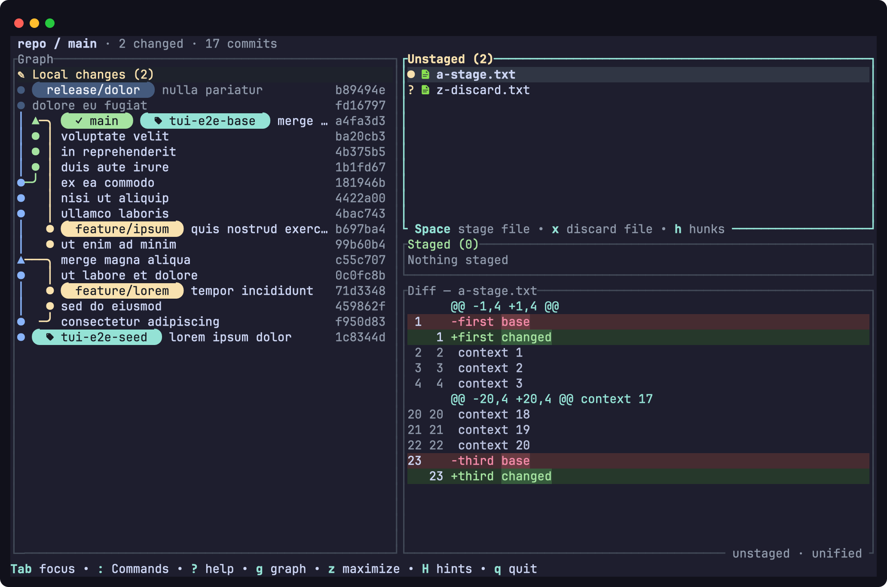
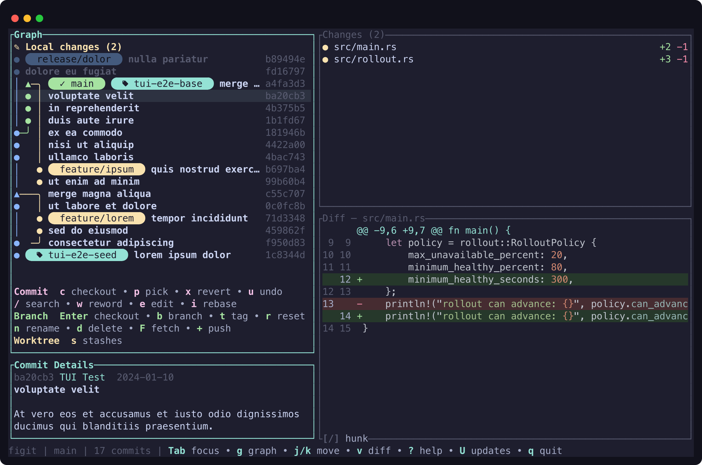
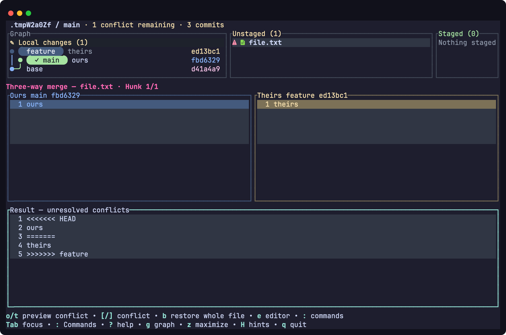
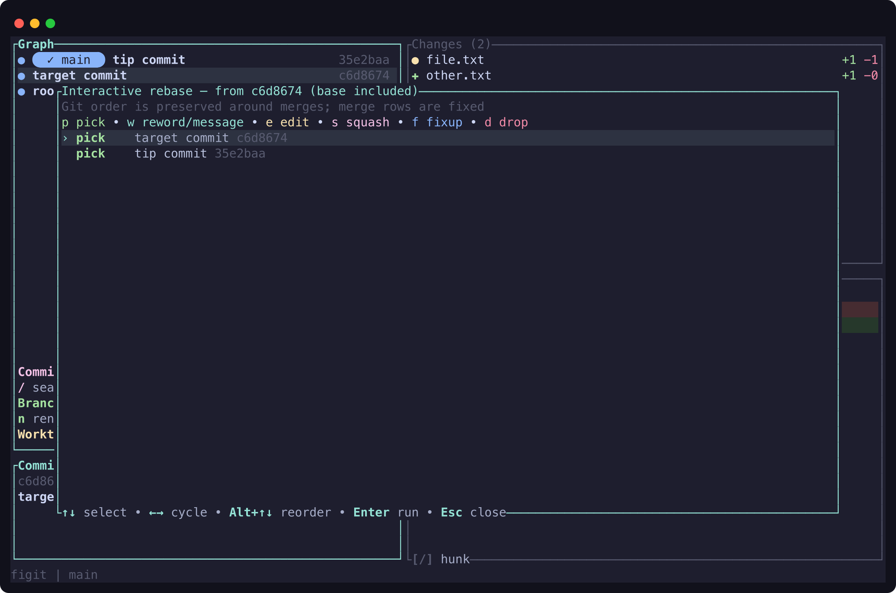
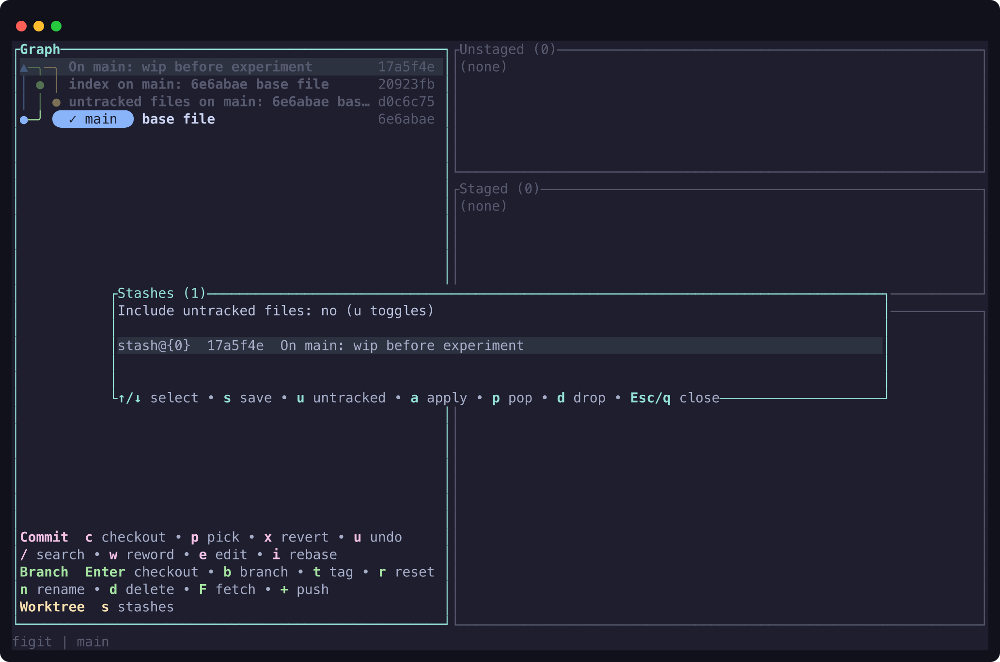

<p align="center">
  
</p>

# figit

[](https://github.com/agom/figit/releases/latest)
[](LICENSE)
[](https://github.com/agom/figit/releases)

A Git TUI.

`figit` renders a multi-lane DAG (merge topology, branch colors, refs) and puts
useful workflows on top of it: file/hunk/line staging, commit/amend/fixup,
branch and tag actions, fetch/pull/push, stash management, interactive rebase,
and conflict resolution.

<p align="center">
  
</p>

Inspecting a commit shows its details and syntax-highlighted diff:

<p align="center">
  
</p>

Resolve merge conflicts with an aligned Ours / Theirs / Result view. The active
conflict is highlighted; `[`/`]` jumps between conflicts. With the resolver
focused, `o`/`t` previews that conflict’s Ours/Theirs version, `Enter` confirms, and `Esc` cancels the preview.
`b` explicitly previews restoring the **entire file** from Base. Use `e` for an
external editor or `:` for resolver commands. Arrow keys, mouse scrolling, and
Page Up/Down keep all three panes synchronized; `z` maximizes the resolver.

The file lists stay compact while resolving conflicts:

<p align="center">
  
</p>

Plan an interactive rebase — reorder, reword, squash, fixup, or drop:

<p align="center">
  
</p>

Manage stashes without leaving the app:

<p align="center">
  
</p>

## Install

Prebuilt binaries support macOS and Linux on Intel/AMD64 and ARM64. Requires
`git` on `PATH`. A [Nerd Font](https://www.nerdfonts.com/) is recommended for
file and branch icons. Windows is not currently a supported release target.

```sh
curl -sSfL https://figit.dev/install | sh
```

Or install from source:

```sh
cargo install --git https://github.com/agom/figit.git
```

Press `U` to check for or install an update, then restart.
Source and package-manager installations use their own update mechanism.

## Usage

```sh
figit [PATH]        # open PATH (defaults to the current directory)
figit --help
figit --version
```

## Key map

### General

| Key | Action |
| --- | --- |
| `Tab` / `Shift+Tab` | Focus the next / previous panel |
| `g` | Toggle the graph pane |
| `z` | Maximize / restore the focused panel |
| `j` / `k` (or `↑` / `↓`) | Move the selection / scroll |
| `/` | Search loaded commit titles and descriptions: type a query, `Enter` runs it, `↑`/`↓` jump to a match, `Esc` closes |
| `u` | Undo: pick a reflog entry (`↑`/`↓`, then `Enter` restores) |
| `U` | Check for or install an update |
| `:` | Fuzzy-find commands for the focused panel |
| `Shift+H` | Show / hide shortcuts in the focused panel’s bottom border |
| `?` | Toggle the in-app key map |
| `q` | Quit |
| `Esc` | Close the active overlay |

The focused panel shows compact shortcuts in its bottom border. The graph
prioritizes Fetch, Pull, Checkout, and Search; Pull appears only when `p` pulls
the current branch. Other panels show up to three relevant shortcuts.
Hints adapt to the selected file and diff mode, and fit without wrapping in narrow
panels. Press `Shift+H` to hide or show them for the current session; hints start
visible on each launch. Press `?` for the full key map.

Commit search covers the history currently loaded in the graph. Older commits
load as you navigate toward the end of the graph; rerun the search to include them.

Press `:` to open commands above the focused panel’s bottom border. Type to
fuzzy-filter command names, use `↑`/`↓` to select, `Enter` to run, and `Esc` to
close. Commands depend on the current panel and selection. Existing confirmation
dialogs still apply. Printable keys, including `j`/`k`, enter text in the picker.
The existing context-sensitive `p` shortcut still cherry-picks other commits;
Cherry-pick is also available in the Graph command picker.

External repository changes refresh automatically. If filesystem watching is
unavailable (for example, Linux watch limits are reached), Figit falls back to
background polling every five seconds.

### Graph

| Key | Action |
| --- | --- |
| `Enter` | Check out the selected ref / commit |
| `c` | Checkout |
| `b` / `t` | Create branch / tag (the tag popup can push the tag with `Ctrl-P`) |
| `r` | Reset (soft, mixed, hard) |
| `n` / `d` | Rename branch / delete branch or tag (←/→ picks the target; `r` also deletes remotely) |
| `p` | Cherry-pick, or pull when the selected commit is the current branch |
| `x` | Revert commit |
| `w` / `e` | Reword / edit commit (edit pauses an interactive rebase) |
| `i` | Interactive rebase plan |
| `R` | Rebase the checked-out branch onto the selected commit or ref |
| `F` | Fetch |
| `+` | Push the selected branch, or the selected tag when the commit has no branch |

Local branches whose configured upstream no longer exists are marked with `✗`.

### Staging and diff

Hide the graph with `g` for a full-width diff below side-by-side Unstaged and
Staged lists. When inspecting a commit, Changes and Commit Details occupy the
top row. Empty lists shrink without moving the diff boundary; `Tab` follows
these panels from left to right, then moves to the diff. Use `z` to maximize
any focused panel. Selection, diff mode, and scroll position carry across layouts
(scroll is clamped when the visible area grows).

The header shows the repository, branch, and working-tree state. Contextual keys
appear along the bottom; `?` opens the full shortcut reference. Colors adapt to
the terminal background. Focused graph and file selections use a subtle neutral background,
preserving icon and change-count colors. With `NO_COLOR`, the active filename or
commit subject is bold and underlined; inactive selections remain bold.

File rows and branch indicators use Nerd Font icons; install a
[Nerd Font](https://www.nerdfonts.com/) to render them (without one the glyphs
show as placeholder boxes).

| Key | Action |
| --- | --- |
| `Space` | Stage/unstage the selected file, hunk, or line |
| `f` / `h` / `l` | File / hunk / line mode |
| `F` | Apply the whole file |
| `x` | Discard unstaged changes |
| `s` | Stash manager |
| `c` / `a` | Commit / amend |
| `v` | Toggle unified and side-by-side diffs |
| `[` / `]` | Previous / next hunk |
| `j` / `k` | Previous / next changed line in line mode |
| `←` / `→` | Pan the diff horizontally |
| `L` | Load the full diff when a large diff was truncated |

In file mode, `f` from staging starts fixup target selection; `Enter` confirms
the selected commit and `Esc` cancels back to staging.

### Conflict resolver

| Key | Action |
| --- | --- |
| `o` / `t` | Preview Ours / Theirs for the selected hunk (or whole file when no text hunk exists) |
| `b` | Preview restoring the entire file from Base |
| `e` | Open the file in `$VISUAL` / `$EDITOR` |
| `Enter` | Confirm the previewed result (including deletion when the chosen side has no file) |
| `Esc` | Cancel the preview without changing the file |
| `[` / `]`, `h` / `l` | Switch hunk, pan |

### Stash manager (`s`)

| Key | Action |
| --- | --- |
| `↑` / `↓` | Select a stash |
| `u` | Include untracked files |
| `s` | Save a new stash |
| `a` | Apply the selected stash |
| `p` | Pop the selected stash |
| `d` | Drop the selected stash |
| `Esc` / `q` | Close |

While saving, type a message and press `Enter` (`Tab` toggles untracked, `Esc`
cancels); dropping asks to confirm with `y` or `Enter`.

### Rebase

| Key | Action |
| --- | --- |
| `↑` / `↓` | Move between commits |
| `Alt`+`↑` / `Alt`+`↓` | Reorder the selected commit |
| `←` / `→` or `Space` | Cycle the action |
| `p` / `w` / `e` / `s` / `f` / `d` | pick / reword / edit / squash / fixup / drop |
| `Enter` | Run the plan |
| `Ctrl+C` | Continue a paused rebase |
| `Ctrl+A` | Abort a paused rebase |
| `c` | Replace the edited commit while paused |

## License

MIT
